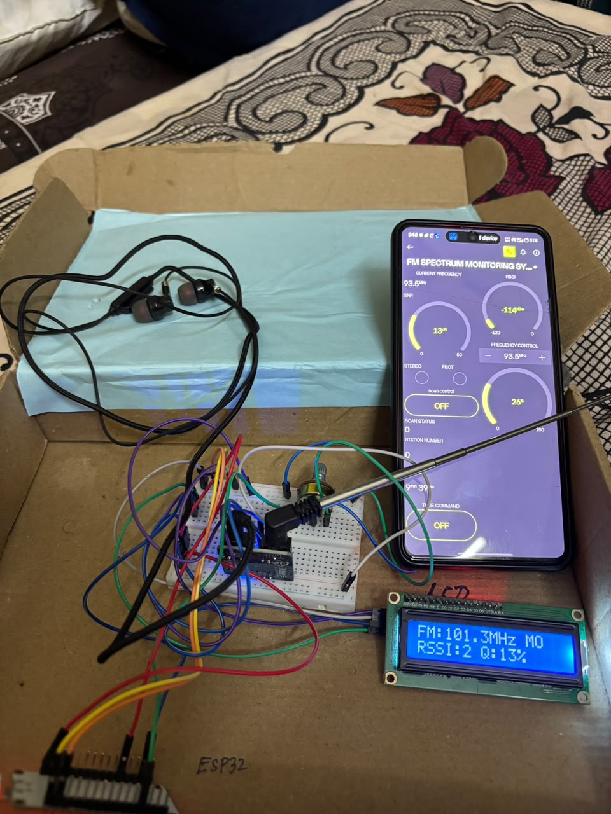
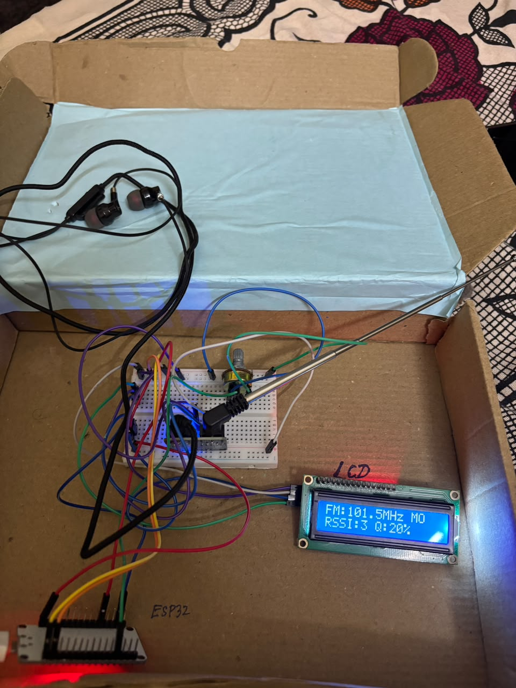

# FM Spectrum Monitoring System (ESP32)

An ESP32-based FM radio monitoring system that tunes the FM band, measures signal strength and quality, shows the results on a 16x2 LCD, and streams everything live to a mobile IoT dashboard. It can also scan the whole band, count the stations and tune to the strongest one.

## Photos
| Hardware with mobile dashboard | Hardware and LCD |
|---|---|
|  |  |

## Features
- Tune from 87.5 to 108.0 MHz using the app, a tune button or a potentiometer
- Live signal strength (RSSI), SNR, signal quality and stereo/pilot status
- Automatic band scan with station counting and tuning to the strongest station
- 16x2 I2C LCD showing frequency, mono/stereo, RSSI level and quality
- Earphone audio output
- Remote monitoring and control from a mobile dashboard

## Components
| Component | Quantity |
|---|---|
| ESP32 development board | 1 |
| TEA5767 FM radio module | 1 |
| 16x2 LCD with I2C backpack | 1 |
| Potentiometer | 1 |
| Telescopic antenna | 1 |
| 3.5 mm earphones / audio jack | 1 |
| Breadboard and jumper wires | - |

> Update this list if you used a different FM module (for example RDA5807M).

## Pin connections
| Part | ESP32 pin |
|---|---|
| FM module SDA / LCD SDA | GPIO 21 |
| FM module SCL / LCD SCL | GPIO 22 |
| Potentiometer wiper | GPIO 34 |
| Power (3.3 V / 5 V per module) and GND | 3V3 / VIN, GND |

The FM module (address `0x60`) and the LCD (address `0x27`) share the same I2C bus.

## Dashboard (Blynk) datastreams
| Virtual pin | Widget |
|---|---|
| V0 | Current frequency |
| V1 | Frequency control (87.5 - 108.0) |
| V2 | RSSI gauge (dBm) |
| V3 | SNR gauge (dB) |
| V4 | Signal quality gauge (%) |
| V5 / V6 | Stereo / Pilot LEDs |
| V7 | Scan control switch |
| V8 | Scan status (text) |
| V9 | Station number |
| V10 | Uptime (text) |
| V11 | Tune command button |

## Setup
1. Install the [Arduino IDE](https://www.arduino.cc/en/software) and ESP32 board support.
2. Install these libraries from the Library Manager: **Blynk** and **LiquidCrystal I2C**.
3. Create a Blynk template with the datastreams above and copy its Template ID and Auth Token.
4. In `code/`, copy `secrets_example.h` to `secrets.h` and enter your Blynk and Wi-Fi details.
5. Open `code/fm_spectrum_monitor.ino`, select your ESP32 board and port, and upload.
6. Plug in earphones, extend the antenna, and tune.

## How it works
- The ESP32 sends the frequency to the FM module over I2C and reads back its signal level and stereo flag.
- RSSI (dBm), SNR (dB) and quality (%) are estimated from the module's 0-15 signal level.
- During a scan, the ESP32 steps through the band in 0.1 MHz steps, records the level at each step, detects peaks as stations, and tunes to the strongest one.

## Future improvements
- RDS station name display
- Spectrum graph of the whole band
- Save favourite stations
- Data logging

## Author
Your Name - [GitHub profile link]

## License
MIT License
